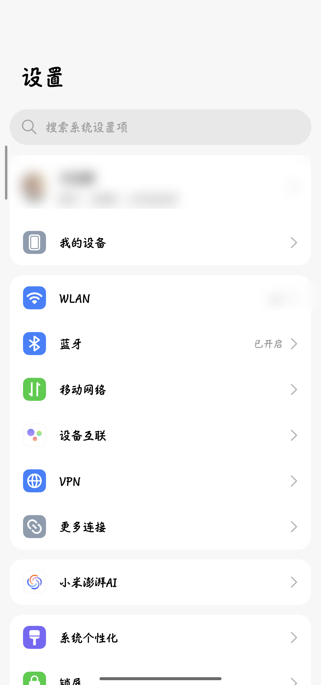
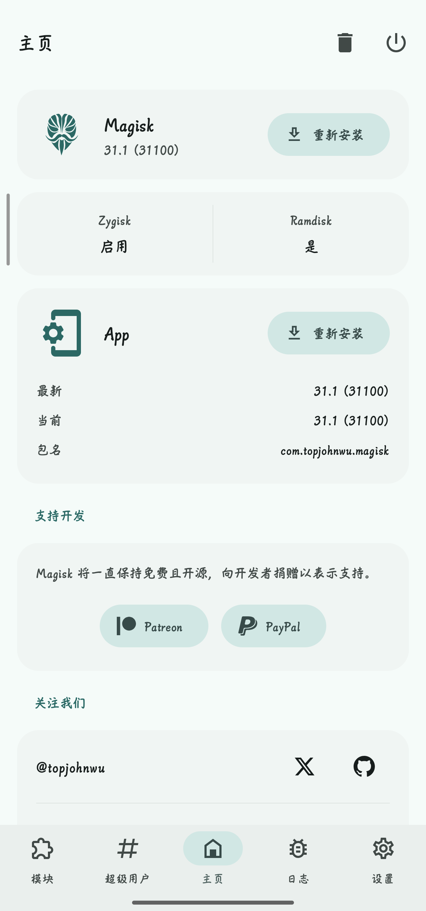
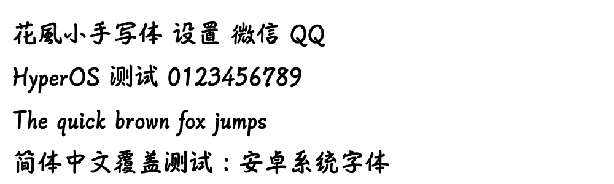

# 花風手写体 · HyperOS 适配版（Magisk 字体模块）

把「花風マーカー体」手写体做成 **Magisk 模块**，解决 HyperOS / MIUI 高版本上
**系统设置、微信、QQ 等第三方 App 字体不生效**的问题。

- 适配系统：HyperOS 1 ~ 4 / MIUI 12.5+（Android 13 ~ 17）
- 模块版本：v8.1-hyperos4
- 依赖：Magisk 20.4+
- 实测机型：Xiaomi 14（houji）/ HyperOS 3 `V816` / Android 16 / Magisk 31.1
- 适配目标机型：Xiaomi「piano」/ HyperOS 4（Android 17）

> 本仓库只做**高版本系统适配与打包**，字体文件本身未做任何修改。
> 字体版权归原作者所有，本仓库作者及转载渠道均非版权方。

## 效果预览

| 系统设置 | Magisk（第三方 App） |
|---|---|
|  |  |

字体样张（中文 + 拉丁）：



> 截图中账号信息、Wi-Fi 名称等个人内容已做模糊处理。


---

## 一、为什么旧模块在 HyperOS 上不生效

真机（HyperOS 3/4）实测的字体链路：

| 项 | 实际指向 |
|---|---|
| `/system/etc/fonts.xml` | 软链 → `/data/system/fonts/theme_webview/fonts.xml` → `/system_ext/etc/hyper_fonts.xml` |
| `/system/etc/font_fallback.xml` | 软链 → `/system_ext/etc/hyper_font_fallback.xml` |
| 命名族 `sans-serif`（所有 App 默认字体） | `/system/fonts/Roboto-Regular.ttf` |
| 中文回退 `Fallback Family lang="zh"` | **`/system/fonts/MiSansL3.otf`** |
| 小米字体（`MiSansVF` / `MiSansLatinVF` / `MiSansTCVF` …） | 真实文件在 **`/product/fonts/`**，`/system/fonts/` 下只是软链 |

因此：

1. 只换 `MiSansVF.ttf` → 设置、微信等走 `sans-serif` + `zh` 回退的 App 完全不变；
2. 只换 `Roboto-Regular.ttf` → 中文仍然回退到 `MiSansL3.otf`，中文不变；
3. 只改 `/system/etc/fonts.xml` → 它是软链，模块覆盖无效（真机已确认）。

## 二、本模块做了什么

安装时把唯一的字体母版 `master/font.ttf`（23.5 MB，20976 个汉字 + 拉丁）
以**硬链接**方式映射成 24 个系统真实字体文件名，同时铺到 `system/fonts/` 与 `product/fonts/`：

```
Roboto-Regular.ttf  Roboto-Italic.ttf  RobotoFlex-Regular.ttf  RobotoStatic-Regular.ttf
RobotoCondensed-Regular.ttf  RobotoCondensed-Italic.ttf  DroidSans.ttf  DroidSans-Bold.ttf
SourceSansPro-Regular/Bold/SemiBold/Italic/BoldItalic/SemiBoldItalic.ttf
MiSans-Regular.ttf  MiSans-Medium.ttf  MiSans-Bold.ttf  MiSansVF.ttf
MiSansLatinVF.ttf  MiSansTCVF.ttf  MiSansJapaneseVF.ttf  MiSansKoreanVF.ttf
MiSansL3.otf        NotoSansSC-Regular.ttf
```

配套脚本：

- `customize.sh`：安装时生成硬链接（不支持硬链接则自动复制），不额外占用空间；
- `post-fs-data.sh`：开机前清理 `/data/fontconfig`、`/data/system/fonts`、`/data/fonts`
  字体缓存，并对未被挂载的字体做 `mount --bind` 兜底；
- `service.sh`：开机自检，把字体实际大小、App mmap 的字体、属性写入
  `/sdcard/Download/kafu_font_log.txt`（备用 `/data/local/tmp/kafu_font_log.txt`）。

## 三、安装

1. Magisk → 模块 → 从本地安装 `花風手写体_HyperOS全App覆盖版_v8.zip`；
2. **完全重启**（不要只软重启）；
3. 若个别界面仍为旧字体：主题商店 → 字体 → 恢复「默认字体」，再重启一次。

卸载：Magisk 中移除模块并重启即可恢复原字体。

## 四、验证

重启后手机「文件管理 → Download → kafu_font_log.txt」，关键字体大小应为 `23502360`：

```
/system/fonts/MiSansL3.otf        23502360
/system/fonts/Roboto-Regular.ttf  23502360
/product/fonts/MiSansL3.otf       23502360
```

也可以在 root 终端看微信实际加载的字体：

```sh
cat /proc/$(pidof com.tencent.mm)/maps | grep -E 'MiSansL3|Roboto-Regular'
```

> 实测结果：刷入后系统设置、微信、Magisk 等 App 的中英文均显示手写体；
> `com.android.settings`、`com.tencent.mm` 的 `maps` 已由 `/product/fonts/MiSansL3.otf`
> 切换为模块提供的 `/system/fonts/MiSansL3.otf`。

## 五、下载

见 [Releases](../../releases) 页面：

- 资产文件：`huafeng-font-hyperos-v8.1.zip`
  （GitHub 资产名使用 ASCII，模块内部名称仍为「花風手写体」）

```
SHA256: D0D01B5C7CBB8307A1D708C1A7666117ED4FAD5F21F956575A542FCB595BF1C5
```

## 六、说明与限制

- 手写体为单字重，粗体由系统伪粗体合成，属正常现象；
- 字库含 20976 个汉字（覆盖 GB2312 / GBK 常用字）与拉丁字母、数字，生僻字自动回退系统 Noto；
- 未替换 serif / monospace / emoji 家族，避免表情与代码字体异常；
- 仅替换字体文件，不修改 `fonts.xml`，最大程度降低开机风险。

---

## 七、版权与免责声明

- **本字体（花風マーカー体）并非本人原创，版权归原字体作者所有。**
  本项目作者**不是**版权方，也不代表任何版权方；
- 该字体最初经微信公众号「字由心雨」获取，**该公众号同样是转载方，并非版权方**；
- 本项目**仅针对高版本 HyperOS / MIUI 的字体加载机制做适配与打包**，不改动字体文件本身，
  不以盈利为目的，不提供任何字体商用授权；
- **如有侵权，请字体作者或权利方邮件联系：wwb2217592760@163.com**
  说明具体情况，收到通知后将**立即删除本仓库及相关发布文件**；
- 如需商业使用，请自行联系原字体作者获取授权。

## 八、仓库结构

```
.
├── module/          # 模块源码
│   ├── customize.sh      # 安装脚本：硬链接生成 24 个字体文件
│   ├── post-fs-data.sh   # 清缓存 + bind mount 兜底
│   ├── service.sh        # 开机自检日志
│   ├── module.prop       # 模块信息
│   └── README.md         # 模块内说明
├── docs/            # 截图
└── README.md
```

字体母版 `master/font.ttf`（23.5 MB）体积较大，随 [Releases](../../releases) 中的 zip 提供。

## 九、致谢

感谢「花風マーカー体」的原作者制作该字体；也感谢转载渠道微信公众号「字由心雨」。
